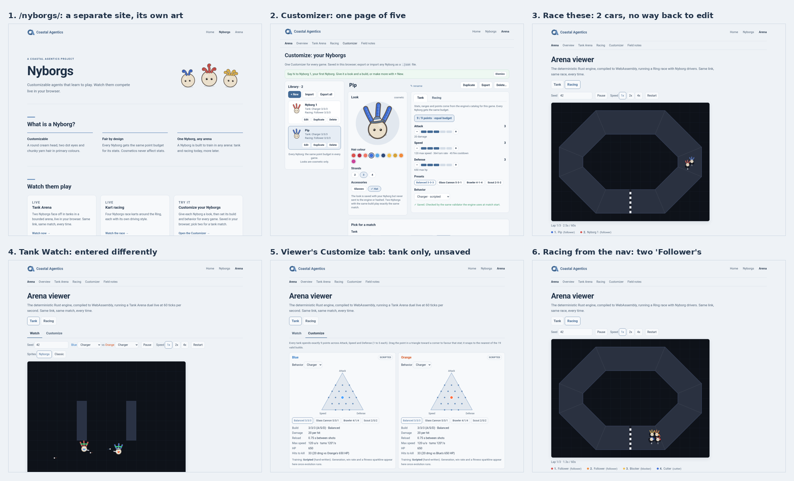
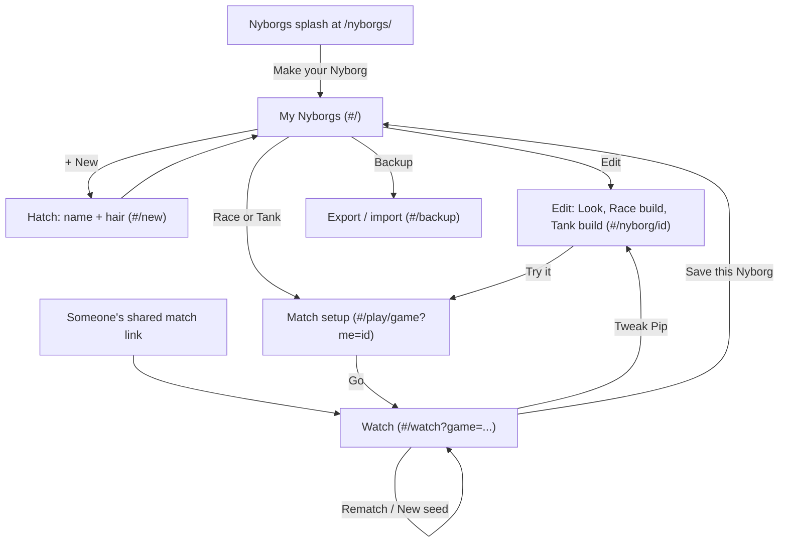
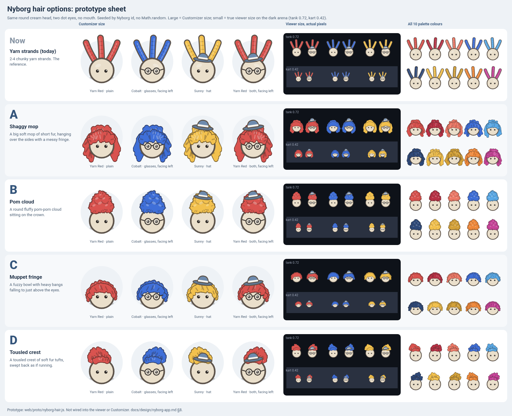

# The Nyborg app: make your Nyborg, then race it or put it in the arena

**Status:** Strategy for Nye to pick from (2026-10-11). Docs and a hair prototype only: nothing in the viewer, the Customizer, the engine or the save format changes in this PR.
**Author:** Blitzwing /nyborg. Builds on [nyborg.md](nyborg.md), [nyborg-library.md](nyborg-library.md), [game-system.md](game-system.md) and [viewer-multi-game.md](viewer-multi-game.md).

**In one line:** one friendly app where you make your Nyborg, pick an arena, watch it play with its own look and name, and come back to tweak it. It lives at `/arena/play/`, it's built from the pieces we already have, and it grows in seven small PRs.

Nye asked for two things: *"customize your nyborg and then race it or put it in the arena"*, and hair that doesn't bother him. Sections 1–7 and 9–11 cover the first. Section 8 covers the hair, with four fuzzy options to pick from.

---

## 1. Where we are today

All the parts exist: a library of Nyborgs saved in your browser, a Customizer with a look and a build for every game, a viewer that plays tank and racing, and links that carry your Nyborgs into a match. They just don't feel like one thing yet. I walked the journey on the live sites in a fresh headless browser (splash → overview → Customizer → Race these / Watch → viewer → back).



**The top 5 places it comes apart:**

1. **Your Nyborg has no home.** The Customizer is one link out of five in the sub-nav. The splash and the overview both lead with house matches first. On a first visit you get "Nyborg 1", and its match pick starts as Nyborg 1 vs Nyborg 1.
2. **Two customizers, and two ways in.** The Customizer (library, every game, saved) and the viewer's own Customize tab (tank only, anonymous Blue and Orange, never saved) don't know about each other, and the splash links to the second as "Customize a tank match". Racing has no in-viewer customize at all. Tank is "Watch ▶" and racing is "Race these ▶". The sub-nav says "Tank Arena" and "Racing" while the splash says "Kart racing".
3. **It's a one-way trip.** Once you're watching, nothing leads back to the Nyborg you're watching: no "tweak Pip", no rematch, no "that one's yours". Flipping the viewer's Tank/Racing toggle drops your Nyborgs and shows the house cast. Race these with two Nyborgs puts only two cars on the track, because nothing fills the grid with house Nyborgs.
4. **Identity isn't carried all the way.** House Nyborgs have no names: the default race has two cars both called "Follower", and the default tank match is just "Kiter" vs "Charger". The splash art draws curly tentacle hair that the app never draws. Hair style isn't part of a Nyborg at all yet.
5. **Two sites, and data in one browser.** `/nyborgs/` (its own repo) and `/arena/` are separate sites whose copy has already drifted: the splash still says "pick two for a tank match", and the viewer introduces itself as "the deterministic Rust engine, compiled to WebAssembly". The library lives only in this browser's localStorage. You can't keep a Nyborg you saw in someone's shared link, short of a JSON file.

**Smaller things:** the devlog is now a redirect to field notes (fine). Both pages work at phone width, but the Customizer is a long scroll on a phone. All three sites share one origin (`coastal-agentics.github.io`), so the library is technically readable from `/nyborgs/` too. Useful later (section 4), and something to remember if a site ever moves to its own domain.

The montage above has the six screens that matter; all thirteen full-size audit screenshots are listed in this PR's work log.

## 2. The proposal: one app, one loop

```
   Make your Nyborg  ──►  Pick an arena  ──►  Watch it play  ──►  Tweak it
          ▲                                                          │
          └──────────────────────────────────────────────────────────┘
```

- **Make or pick your Nyborg.** The app opens on *your* Nyborgs: big friendly cards, each with its face, its name, and a **Race** and a **Tank** button. A first visit hatches your first Nyborg: you give it a name and a hair colour, and that's it.
- **Pick an arena.** Race or Tank, the same way for both (and for any third game). Your Nyborg goes in slot 1. Fill the other slots with more of yours or with **house Nyborgs**, a small named cast with fixed looks (e.g. the racing Follower, Blocker and Cutter as characters). Empty slots fill themselves, so you never race alone by accident.
- **Watch it play.** The same viewer and the same deterministic match, with your Nyborg drawn in its own look, wearing a small "you" marker, and named on the board. At the end, a finish card offers **Tweak Pip**, **Rematch**, **New seed** and **Share**.
- **Tweak it.** "Tweak Pip" opens the editor on that arena's build tab. Change a point, go again.

Everything stays as fair and repeatable as today: same 9-point budget, cosmetics never touch the sim, same link → same match (section 10).

## 3. Screens, flow and URLs

### Screens

| Screen | Route | What's on it |
| --- | --- | --- |
| **My Nyborgs** (home) | `#/` | Your library as cards (face, name, build per arena), **Race** / **Tank** on each, **+ New**. The selected Nyborg is the big one. |
| **Hatch** | `#/new` | Name and hair colour (and style, once section 8 lands). One screen, then straight to home or to a first race. |
| **Edit** | `#/nyborg/<id>` and `#/nyborg/<id>/<game>` | Look tab, plus one build tab per arena from the engine's catalog (today's schema-driven tabs). The tank triangle comes along as the tank build control. |
| **Match setup** | `#/play/<game>?me=<id>` | Your Nyborg plus opponents (yours or house), slot count from the game, seed with a 🎲 shuffle, **Go**. |
| **Watch** | `#/watch?<match query>` | The viewer, a "you" marker, and the finish card (Tweak / Rematch / New seed / Share). For a link from someone else: **Save Pip to my Nyborgs**. |
| **Backup** | `#/backup` | Export and import (today's Customizer buttons, moved out of the way). |

### Flow



### URLs and routing

- **The app is one static page,** `web/play/index.html`, served at `/arena/play/`. It uses **hash routes** (`#/…`). GitHub Pages has no rewrites, so hash routes never 404, need no server, and keep working from a local `python3 -m http.server`.
- **Match links keep today's query, unchanged.** `#/watch?game=racing&seed=42&cars=…&looks=…&name1=…` uses the exact query that `arena.html?…` reads today (`nyborg-link.js`), so turning one into the other is a string swap and both play the same match.
- **Old links keep working forever.** `arena.html?…` stays and gets an "Open in the Nyborg app" link. Once the app's editor ships (milestone 4), `customizer.html` becomes a redirect to `/arena/play/#/nyborg/<selected>`.
- **Game ids come from the engine** (`games()`): `#/play/racing`, `#/play/tank`, and later `#/play/<third>` with no router change.

## 4. Where it lives

**Recommendation: the app lives in `arena/web`. The nyborgs repo stays the friendly front door and points into it.**

- **arena/web** already has everything the app needs: the committed wasm (`web/pkg`, byte-checked by CI), the library, the build tabs, the viewer, `nyborg-link.js` and the Node tests that import them. Moving the app to the nyborgs repo would mean copying the wasm across repos and losing the CI checks that keep it honest.
- **Both sites share one origin,** so the library in localStorage is the same whichever page you're on. Nothing is lost by keeping the app under `/arena/`.
- **What the splash links to:** its big button becomes **Make your Nyborg → `/arena/play/`**. The three cards become **Race** (`/arena/play/#/play/racing`), **Tank** (`/arena/play/#/play/tank`) and **Your Nyborgs** (`/arena/play/`). Field notes and the Arena overview stay as quieter links. The header art is regenerated from the chosen hair (section 8), so the splash draws the same Nyborgs as the app.
- **Optional nicety (open question 7):** the splash could say "Welcome back, Pip" with a tiny read-only script, since the library sits on the same origin.
- **The arena overview** (`/arena/`) stays the story of the engine and the experiments. Its sub-nav gets **Play** first.

```
coastal-agentics.github.io/
├── /             company site
├── /nyborgs/     the front door: what a Nyborg is, "Make your Nyborg" ─┐
└── /arena/       the engine and games                                  │
    ├── play/     THE NYBORG APP  ◄─────────────────────────────────────┘
    ├── arena.html, customizer.html   (old links keep working)
    └── fieldnotes.html, index.html   (overview)
```

## 5. The shared Nyborg data model

### Today: save format 1 (unchanged by this PR)

```json
{
  "format": 1,
  "id": "3f2c…-uuid",
  "name": "Pip",
  "created": "2026-10-06T22:06:00Z",
  "updated": "2026-10-06T22:06:00Z",
  "look": { "hair_color": "#3F6FD8", "strands": 3, "accessories": ["hat"] },
  "builds": {
    "racing": { "rules_version": 1, "levels": { "power": 3, "top_speed": 3, "grip": 3 }, "behavior": { "kind": "scripted", "id": "follower" } },
    "tank":   { "rules_version": 1, "levels": { "attack": 3, "speed": 3, "defense": 3 }, "behavior": { "kind": "scripted", "id": "charger" } }
  }
}
```

It's stored as `arena.nyborg.p.<id>` plus `arena.nyborg.index` (order and selected) and `arena.nyborg.picks`. **The selected Nyborg becomes "my Nyborg" on the home screen.** No new storage keys are needed for milestones 1–4.

### Next: save format 2 adds the hair style (milestone 5, after Nye picks)

```json
"look": { "hair_style": "mop", "hair_color": "#3F6FD8", "strands": 3, "accessories": ["hat"] }
```

- **`hair_style`** (required in format 2): `"yarn"` (today's strands) or one of the styles Nye picks from section 8 (`"mop"`, `"pom"`, `"fringe"`, `"crest"`).
- **`strands`** stays and only means something for `"yarn"`. That way a Nyborg can switch back to yarn without losing its strand count.
- **Why a format bump rather than a quiet new field:** today's code already shows a newer-format Nyborg read-only and refuses to import it (`readOnly`, "made by a newer version"). So an old cached tab can never save over a format-2 Nyborg and drop its hair style.
- **Migration 1 → 2:** on first load, a one-time copy goes to the reserved `arena.nyborg.backup.v1` key, then every Nyborg gets `hair_style: "yarn"`, so nobody's Nyborg changes behind their back (or the new default; open question 2).
- **The fuzz is seeded by `id`,** so Pip's tufts are the same on every screen and every machine. House Nyborgs get fixed ids (`house-racing-follower`, …) for the same reason.
- **Links:** today's look token is `D9534F-3-gh`. The second field becomes *either* a strand count `2|3|4` (yarn, exactly as today) *or* a style letter: `m` mop, `p` pom, `f` fringe, `c` crest. Every link already shared still decodes to the same look.
- **House Nyborgs** are plain format-2 objects in a small module (`web/house.js`), one cast per game: names, looks and a build. In links they're just builds, looks and names, so no new link format is needed.
- **The engine never sees `look`**, exactly as today.

## 6. The arena plug-in contract

A third game has to plug in exactly the way tank and racing do, with no edits to the app's screens. The contract has two halves.

**Engine side** (Shockwave's, already true for tank and racing):

| Call | Gives |
| --- | --- |
| `games()` | `[{game, rules_version}]`: the app's list of arenas |
| `catalogJson(game)` | stats (each 1–5, total 9), behaviors, presets: drives the Edit tab |
| `defaultBuild(game)`, `validateBuild(game, build)` | the default build, and `{ok, errors}`; nothing unchecked ever plays |
| a match from `(seed, builds[])` | deterministic `step()`, `state()` and a state hash |

**Web side** (mine): one module per game, `web/games/<game>.js`, registered in one list.

```js
export default {
  id: "racing",                 // matches games()
  title: "Racing", verb: "Race",
  slots: { min: 2, max: 4 },    // you take slot 1; empty slots get house Nyborgs
  house: [/* format-2 Nyborgs */],
  parseQuery(params, engine),   // link -> {seed, builds, looks, names, notes}
  toQuery(spec, engine),        // spec -> link query (today's format)
  start(wasm, spec),            // -> match {step, state, hash, done}
  draw(ctx, match, cast),       // cast[i] = {name, look, id, you}
  board(match, cast),           // the HUD / leaderboard
  result(match, cast),          // -> [{slot, place, line}] for the finish card
};
```

Today, `tank-ui.js` and `race-ui.js` are already most of the way there. `arena.js` still branches on `game === "racing"`; milestone 3 moves those branches into the two modules. **Acceptance for the contract:** a test registers a fake third game and checks that it shows up on home, match setup, watch and the editor with no screen code changes. That extends today's "a third game needs no Customizer change" test.

## 7. Technical approach

| Option | Good | Costs |
| --- | --- | --- |
| **A. Vanilla ES modules + committed wasm (today)** | Pages deploys `web/` as-is. Node tests import the real modules. The wasm byte-check keeps working. Nothing new to learn. | We write our own tiny router and screen helper (~150 lines) |
| B. Vanilla + one vendored ESM file (e.g. preact + htm, ~5 KB, no build) | Nicer templating for the busier screens | One third-party file to keep current |
| C. A bundler + framework (Vite, React or Svelte) | Big ecosystem, TypeScript | A build step in `pages.yml` and `ci.yml` (`.github/` isn't mine to change), npm in CI, and the wasm byte-check gets more complicated. All of that for an app of a few thousand lines. |

**Recommendation: A.** The whole web side is about 3,100 lines today and the app might double it. That's comfortably vanilla territory, and it keeps the thing Nye liked from the start: a static site with no build, no trackers and nothing to install. The house kit:

- `web/app/router.js`: hash routes → screen modules, each with `mount(el, params)` and `unmount()`.
- `web/app/ui.js`: the small `el()` helper the Customizer already uses, plus focus handling for screen changes.
- One stylesheet of shared tokens, so the app, the old pages and the splash look like one family.
- `// @ts-check` and JSDoc types for the save format, for editor help without a compiler.

**When to revisit:** if a screen gets unwieldy, vendor B (one file, still no build). Go to C only if we ever need npm packages or TypeScript proper, and then with Shockwave, since CI is his.

## 8. Hair options

Nye's direction: primary colours, Muppet-like, fuzzy and shaggy, never vegetable-like. The head stays the same round cream head with two dot eyes and no mouth. Here are four fuzzy treatments, drawn by real canvas code in [`web/proto/nyborg-hair.js`](../../web/proto/nyborg-hair.js). It's a prototype module that nothing imports yet.



| | Style | In a line |
| --- | --- | --- |
| Now | Yarn strands | Today's 2–4 chunky strands, for reference |
| **A** | **Shaggy mop** | A big soft Muppet mop that hangs over the sides, with a messy fringe |
| **B** | **Pom cloud** | A round fluffy pom-pom cloud of puffs sitting on the crown; the most distinct shape at viewer size |
| **C** | **Muppet fringe** | A neat fuzzy bowl with heavy bangs falling to just above the eyes |
| **D** | **Tousled crest** | A soft fanned crest of fur down the middle, swept back as if running |

**How the fuzz works.** Every tuft is a filled, tapered clump with a *round* tip (pointed tips read as spikes, and stroked lines read as sticks). Each style is drawn in three passes: all the clumps a little larger in a dark tint of the hair colour, then a soft base mass, then the clumps in the hair colour. Only the outer edge keeps the dark rim, and at Customizer size a few micro-hairs past each tip make that rim look felted. Viewer-size heads (about 20–30 px) skip the micro-hairs and texture and use fatter clumps, so each style still reads as one clear shaggy shape. Tones are computed from the hair colour, so all ten palette colours work, Navy included.

**Rules it keeps.** No `Math.random`: jitter comes from mulberry32 seeded by an FNV-1a hash of the Nyborg id. The sheet renders byte-identical every time, and `tests/web/hair-proto.test.mjs` checks the same id → same drawing, another id → different tufts, no `Math.random`, and the facing −1 mirror. Facing flips the whole Nyborg, so the bangs' sweep and the crest's lean turn with it. The hat sits on top of each style.

**See it live:** after merge, the sheet page is at `/arena/proto/hair-sheet.html` (not linked from anywhere, `noindex`).

**My suggestion (Nye decides):** **A** as the new default, because it's the most Muppet. Offer **B** and **D** as extra styles you can pick in the Look tab, since they're the most distinct from each other and from A. Keep **yarn** as "classic" so nobody's Nyborg has to change. **C** is close to A at viewer size, so pick one of A or C rather than both.

## 9. Milestones

Small PRs, each one shippable and visible on GitHub Pages the moment it merges. Old pages keep working throughout.

| # | Name | What Nye sees | Acceptance |
| --- | --- | --- | --- |
| 0 | **Strategy + hair sheet** (this PR) | This doc, and the hair sheet at `/arena/proto/hair-sheet.html` | Docs and prototype only. CI green. No change to any page that's linked. |
| 1 | **My Nyborgs home** | `/arena/play/` opens on your Nyborgs as cards with **Race** and **Tank** buttons. A first visit hatches your first Nyborg. The buttons open today's viewer with your Nyborg against house Nyborgs. | Fresh browser → watching your Nyborg in either arena in ≤ 3 clicks. Works at 390 px. Same storage keys, no migration. Node tests for the router and match-link building. |
| 2 | **House Nyborgs + match setup** | One match setup screen for both arenas: you plus opponents (yours or named house Nyborgs). The racing grid fills itself. 🎲 seed. | Built from `games()` and the game modules (no game-name branches). Links in today's format. Same link → same state hash. No duplicate names on the board. |
| 3 | **Watch in the app** | The match plays inside the app, your Nyborg wears a "you" marker, and the finish card offers Tweak / Rematch / New seed / Share. | Every existing `arena.html` link still plays the identical match (state-hash test against today). `arena.js` game branches moved behind the plug-in contract. |
| 4 | **Edit in the app** | Look and per-arena build tabs inside the app. `customizer.html` redirects there. The viewer's Customize tab becomes "Edit in the app", and the tank triangle lives on as the tank build control. | One editor. The library tests still pass. No data loss (same keys). |
| 5 | **New hair** | Nye's chosen style(s) everywhere: Customizer, viewer, the splash art | Save format 2 with a backup-first migration. Old links still render the same looks. Prototype tests carried over. Engine pins and `web/pkg` untouched. Can ship any time after Nye picks, independent of 1–4. |
| 6 | **Save from a link** | Opening someone's match offers **Save Pip to my Nyborgs**. Backup moves to its own screen. | Saved Nyborg = the link's build (engine-checked), look and name. Clear note if a build had to fall back. |
| 7 | **One front door** | The splash's big button is **Make your Nyborg**, its copy is refreshed, and the arena sub-nav starts with **Play** | Every page reaches the app in one click. `tools/shoot.py` link check passes. Copy matches the app. |

Suggested order: 1 → 2 → 3 → 4, with 5 as soon as Nye picks, and 6 and 7 after 3. Each is about one evening's PR.

## 10. Invariants (every milestone, no exceptions)

1. **Equal footing.** Every Nyborg (yours, house or imported) gets exactly the same 9-point budget in every arena, checked by the engine's `validateBuild`. The app never starts a match from an unchecked build.
2. **Cosmetics are cosmetic.** Look, name, hair style, the "you" marker and house characters never reach the engine; only the seed and the builds do. Tested by equal state hashes with and without cosmetics.
3. **Determinism.** Same link → same match, on every machine. Drawing uses no `Math.random`; hair jitter is seeded by Nyborg id.
4. **Pins stay put.** The engine, the game pins (tank smoke digest, bot pins, the M1 champion) and `web/pkg` stay byte-identical. No PR in this plan touches `engine*/`, `scripts/` or `.github/`.
5. **Old links keep working.** Every `arena.html` link ever shared still plays the same match.
6. **Your Nyborgs stay yours.** Saved in your browser, exportable as a file, no accounts, no trackers.

## 11. Open questions for Nye

1. **Hair:** which of A–D? One style for everybody, or a few to choose from? Should yarn stay as a "classic" option?
2. **Existing Nyborgs:** when the new hair lands, keep their yarn, or move everyone to the new default?
3. **Front door:** is `/arena/play/` a good home for the app, with the `/nyborgs/` splash pointing into it? Or should the splash itself become the app?
4. **House Nyborgs:** should they have character names and set looks (say, a cast of three racers and two tank drivers)? Want to name them?
5. **Opponents:** by default, is it your Nyborg against the house, or always pick from your own library?
6. **Saving:** is "in your browser, plus export/import" enough for now? Syncing across devices needs a server, which static Pages can't do.
7. **Welcome back:** should the splash greet a returning visitor by their Nyborg's name? It's possible because the sites share an origin.
8. **The tank triangle:** keep it as the tank build control in the editor (my vote), or use the same +/− rows as racing?

---

*What this PR doesn't change:* no linked page, no save format, no engine, no pins. The prototype sits in `web/proto/` and nothing imports it.
